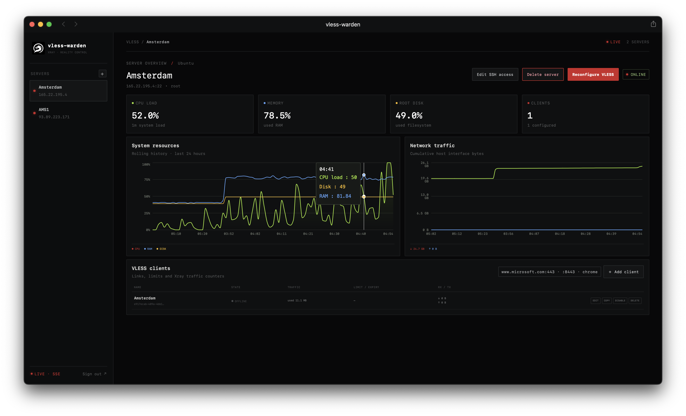

# vless-warden

Self-hosted панель управления Xray VLESS + REALITY серверами. Подключайте свои VPS на Ubuntu или Debian по SSH, устанавливайте Xray, создавайте клиентов VLESS и следите за состоянием серверов в одном веб-интерфейсе.

vless-warden запускается локально через Docker Compose или на собственном VPS (по домену с HTTPS либо по IP). Это не VPN/прокси-хостинг: VPS и SSH-доступ к нему предоставляет пользователь. Трафик клиентов идёт напрямую между устройствами и вашим VPS и не проходит через vless-warden.



## Содержание

- [Возможности](#возможности)
- [Как это устроено](#как-это-устроено)
- [Быстрый старт: локальный запуск](#быстрый-старт-локальный-запуск)
- [Установка на VPS](#установка-на-vps)
- [Подключение управляемого VPS](#подключение-управляемого-vps)
- [Устранение неполадок](#устранение-неполадок)
- [Настройки](#настройки)
- [Резервные копии](#резервные-копии)
- [Разработка](#разработка)
- [API](#api)
- [Безопасность](#безопасность)

## Возможности

**Серверы и VLESS / REALITY**
- Добавление VPS по SSH: пароль или приватный ключ (в том числе с passphrase).
- Запоминание SSH host key после первого успешного подключения.
- Установка и настройка Xray на Ubuntu и Debian в изолированный каталог `/opt/vless-warden` со своим systemd-сервисом `vless-warden-xray.service`.
- Удаление сервера отзывает VLESS-доступ на самом VPS: останавливает сервис, удаляет файлы конфигурации `/etc/vless-warden`, бинарник Xray и правило UFW. Если очистка не удалась, запись сервера не удаляется, чтобы доступ не остался включённым незаметно.

**Клиенты (clients)**
- Создание, включение, отключение, удаление и редактирование клиентов.
- Лимиты трафика и срока действия с автоматическим отключением клиента при их исчерпании.
- Быстрое копирование конфигурационной ссылки `vless://` (REALITY: публичный ключ, shortId, SNI, flow `xtls-rprx-vision`, fingerprint `chrome`).
- Приватные ключи REALITY хранятся в базе в зашифрованном виде (AES-256-GCM).

**Мониторинг**
- CPU, память, корневой диск и сетевой трафик сервера.
- Трафик клиентов (uplink и downlink) через Xray Stats API и статус онлайн.
- Графики истории и обновление статусов в реальном времени через SSE.

**Прочее**
- Регистрация и вход с JWT-аутентификацией.
- Все данные хранятся в вашем PostgreSQL.

## Как это устроено

```text
Браузер → [Caddy: HTTPS на VPS] → Nginx / React → Spring Boot API → PostgreSQL
                                                                           │
                                                                           └── SSH → ваш VPS с Ubuntu или Debian (Xray: VLESS + REALITY)
```

Nginx отдаёт собранный frontend и перенаправляет API-запросы в Spring Boot. Backend хранит данные в PostgreSQL, а для установки Xray, применения конфигураций и сбора метрик через Xray Stats API подключается к вашим VPS по SSH.

| Часть | Технологии |
| --- | --- |
| Backend | Java 21, Spring Boot, Spring Security, Spring Data JPA |
| База данных | PostgreSQL 16, Flyway |
| SSH | Apache MINA SSHD |
| Секреты | AES-256-GCM, ключ `APP_MASTER_KEY` |
| Аутентификация | JWT, пароли хешируются Argon2 |
| Frontend | React 19, TypeScript, Vite, TanStack Query, Recharts, Tailwind CSS |
| Xray core | Зафиксированная версия (`XRAY_VERSION`, по умолчанию `v26.11.9`) |
| Запуск | Docker Compose, Nginx, Caddy (HTTPS на VPS) |

## Быстрый старт: локальный запуск

### Требования

- Docker Desktop (macOS, Windows) либо Docker Engine с Compose v2 (Linux).
- Bash, `curl` и OpenSSL. В macOS и большинстве Linux-дистрибутивов они уже есть.
- В Windows команды запускаются из WSL2 с включённой интеграцией Docker Desktop.

Java, Maven, Node.js и PostgreSQL отдельно ставить не нужно.

### Установка

```bash
git clone https://github.com/kage-xql/vless-warden.git
cd vless-warden
./install.sh
```

Скрипт проверит Docker, создаст `.env`, сгенерирует ключ шифрования и JWT-секрет, соберёт образы, запустит приложение и проверит его состояние. Первый запуск может занять несколько минут.

После установки откройте **http://localhost:8080** и создайте первый аккаунт: установщик напечатает одноразовый setup-токен (он же лежит в `.env` как `APP_BOOTSTRAP_TOKEN`). Без этого токена первый аккаунт создать нельзя, а после него регистрация закрыта. Порт меняется переменной `WEB_PORT` в `.env`. PostgreSQL доступен только с этого компьютера на порту `5432`, поэтому убедитесь, что порт свободен.

### Управление

```bash
./service.sh start     # запустить
./service.sh stop      # остановить
./service.sh restart   # применить изменения из .env
./service.sh status    # проверить состояние
./service.sh logs      # посмотреть логи
```

Сервис работает в фоне и поднимается вместе с Docker, пока его не остановили командой `stop`. Свернуть или закрыть окно Docker Desktop можно, а выход из Docker Desktop остановит контейнеры.

Обновление:

```bash
git pull
./install.sh
```

## Установка на VPS

Панель можно поднять на собственном сервере. Это удобно, когда нужен постоянный мониторинг и доступ с любых устройств. Локальный запуск при этом не затрагивается.

| Режим | Что заполнить в `.env.vps` | Адрес панели | Когда подходит |
| --- | --- | --- | --- |
| **HTTPS с доменом** (рекомендуется) | `APP_DOMAIN=panel.example.com`, `TLS_MODE=acme` | `https://panel.example.com` | постоянная работа |
| **HTTPS по IP** | `APP_DOMAIN=203.0.113.10`, `TLS_MODE=internal` | `https://203.0.113.10` + предупреждение браузера | нет домена, но нужен шифрованный канал |
| **HTTP по IP** | `APP_DOMAIN=` (пусто) | `http://203.0.113.10` | только проверка, трафик не шифруется |

Режим выбирается автоматически по `APP_DOMAIN`: пусто — HTTP-стек `docker-compose.vps.yml`, заполнено — HTTPS-стек `docker-compose.tls.yml` с Caddy. Для IP-адреса установщик сам включает `TLS_MODE=internal`: Let's Encrypt не выдаёт сертификаты на IP.

> [!WARNING]
> В режиме «HTTP по IP» трафик не шифруется. В открытом виде передаются пароль панели, JWT и всё, что вы вводите в форме: SSH-пароли и приватные ключи серверов, а также клиентские ссылки VLESS. Используйте его только для проверки, а для постоянной работы включите HTTPS.

Во всех режимах PostgreSQL доступен только внутри Docker-сети, контейнерам заданы лимиты памяти, а размер логов ограничен.

### Требования

- Ubuntu 22.04/24.04 или Debian 12; 1 ГБ RAM (лучше 2 ГБ), 10 ГБ диска и минимум 3 ГБ свободно под образы.
- Открытые порты: SSH и 80/443 для HTTPS (или только 80 для HTTP-доступа по IP).
- Для HTTPS с доменом: домен или поддомен с A-записью на IP этого VPS.
- Docker и Compose v2 установщик поставит сам.

### 1. Подготовка чистого сервера

<details>
<summary>Один раз на новом VPS: пользователь, обновление, firewall, SSH</summary>

**Пользователь.** Работать под root не нужно: создайте пользователя с `sudo` и перенесите в него SSH-ключ.

```bash
adduser vlesswarden
usermod -aG sudo vlesswarden
rsync --archive --chown=vlesswarden:vlesswarden ~/.ssh /home/vlesswarden
```

Дальше подключайтесь как `ssh vlesswarden@<IP>`.

**Обновление системы и пакеты.**

```bash
sudo apt update && sudo apt full-upgrade -y
sudo apt install -y curl git ca-certificates openssl ufw
```

**Firewall.** Наружу нужны только SSH и порты панели. Порты PostgreSQL (`5432`) и backend (`8081`) не публикуются, открывать их не надо.

```bash
sudo ufw allow OpenSSH
sudo ufw allow 80/tcp     # HTTP: проверка домена и редирект на HTTPS
sudo ufw allow 443/tcp    # HTTPS
sudo ufw allow 443/udp    # HTTP/3, необязательно
sudo ufw enable
sudo ufw status
```

Без домена панель слушает один порт (`WEB_PORT`, по умолчанию 80), и достаточно `sudo ufw allow 80/tcp`. Если у провайдера есть свой firewall (Hetzner, Oracle, AWS, Vultr, DigitalOcean), откройте те же порты и там: `ufw` его не заменяет.

**SSH.** Убедившись, что вход по ключу работает, создайте `/etc/ssh/sshd_config.d/99-hardening.conf`:

```text
PermitRootLogin no
PasswordAuthentication no
```

Затем выполните `sudo systemctl reload ssh`.

**Swap.** Если RAM меньше 2 ГБ и swap нет, установщик создаст swap-файл на 2 ГБ: без него сборка образов может завершиться по нехватке памяти. После установки swap лучше оставить включённым (проверка: `free -h`).

</details>

### 2. Установка

```bash
ssh vlesswarden@<IP>
git clone https://github.com/kage-xql/vless-warden.git
cd vless-warden
./deploy/vps-install.sh
```

Скрипт установит Docker (если его нет), создаст swap при необходимости, сгенерирует секреты в `.env.vps`, последовательно соберёт образы и дождётся health-check. На слабом VPS первая сборка занимает 5-15 минут. В конце скрипт напечатает адрес панели.

Если порт 80 занят: в режиме HTTP по IP задайте `WEB_PORT=8080`, в режиме HTTPS — `HTTP_PORT` и `HTTPS_PORT`. После правки запустите установку снова.

### 3. Включите HTTPS

#### Вариант A — домен с Let's Encrypt (рекомендуется)

1. Направьте A-запись домена на IP сервера и дождитесь, пока она начнёт резолвиться:

```bash
dig +short panel.example.com     # должен вернуть IP этого VPS
```

2. Откройте порты в `ufw` и у провайдера (DigitalOcean Cloud Firewall, Security Group и т. п.):

```bash
sudo ufw allow 80/tcp
sudo ufw allow 443/tcp
sudo ufw allow 443/udp    # HTTP/3, необязательно
```

3. Укажите домен и перезапустите установку:

```bash
cd ~/vless-warden

sed -i 's|^APP_DOMAIN=.*|APP_DOMAIN=panel.example.com|' .env.vps
grep -q '^APP_DOMAIN=' .env.vps || echo 'APP_DOMAIN=panel.example.com' >> .env.vps

sed -i 's|^TLS_MODE=.*|TLS_MODE=acme|' .env.vps
grep -q '^TLS_MODE=' .env.vps || echo 'TLS_MODE=acme' >> .env.vps

./deploy/vps-install.sh
```

Caddy выпустит сертификат Let's Encrypt и будет его продлевать, HTTP-запросы перенаправятся на HTTPS. Сертификаты лежат в volume `vless-warden_caddy_data` и переживают перезапуск контейнеров.

#### Вариант B — HTTPS по IP (самоподписанный)

Подходит, если домена нет, но пароль и SSH-ключи нельзя гонять открытым текстом. Браузер покажет предупреждение о недоверенном сертификате — трафик при этом шифруется.

```bash
cd ~/vless-warden

IP="$(curl -fsS --max-time 5 https://api.ipify.org)"
sed -i "s|^APP_DOMAIN=.*|APP_DOMAIN=${IP}|" .env.vps
grep -q '^APP_DOMAIN=' .env.vps || echo "APP_DOMAIN=${IP}" >> .env.vps

sed -i 's|^TLS_MODE=.*|TLS_MODE=internal|' .env.vps
grep -q '^TLS_MODE=' .env.vps || echo 'TLS_MODE=internal' >> .env.vps

./deploy/vps-install.sh
```

Открывайте `https://<IP>`, в предупреждении браузера — «Дополнительно → Перейти на сайт». Чтобы убрать предупреждение (и проблемы с входом в Safari), вытащите корневой сертификат Caddy и сделайте его доверенным на своих устройствах:

```bash
docker compose -f docker-compose.tls.yml --env-file .env.vps \
  exec caddy cat /data/caddy/pki/authorities/local/root.crt > caddy-root.crt
```

macOS (нужен пароль администратора):

```bash
sudo security add-trusted-cert -d -r trustRoot \
  -k /Library/Keychains/System.keychain caddy-root.crt
```

Windows: двойной клик по `caddy-root.crt` → «Установить сертификат» → «Локальный компьютер» → «Доверенные корневые центры сертификации».

iOS/iPadOS: отправьте `caddy-root.crt` на устройство, откройте → «Профиль загружен» → «Установить», затем **Настройки → Основные → Об этом устройстве → Доверие сертификатам** → включите `Caddy Local Authority`.

> [!IMPORTANT]
> Safari не переносит исключение «Перейти на сайт» на запросы `fetch`/XHR: страница открывается, а вход падает с `Load failed`. В Chrome/Firefox после «Proceed» вход обычно работает. Надёжно лечится доверенным сертификатом (команды выше) или доменом с Let's Encrypt.

#### Переключение между HTTP и HTTPS

Установщик сам останавливает контейнеры предыдущего стека перед запуском нового — вручную удалять контейнеры не нужно. Достаточно поменять `APP_DOMAIN`/`TLS_MODE` в `.env.vps` и выполнить:

```bash
./deploy/vps-install.sh
```

Если на старой версии возникла ошибка `could not find a network matching network mode vless-warden_default`, сначала удалите контейнеры старого стека, затем повторите установку:

```bash
docker compose -f docker-compose.tls.yml --env-file .env.vps down --remove-orphans || true
./deploy/vps-install.sh
```

#### Проверка после установки

```bash
# health через HTTPS (для самоподписанного сертификата нужен -k)
curl -k -sS https://<IP-или-домен>/actuator/health
# {"status":"UP"}

# состояние контейнеров и логи Caddy
./deploy/vps-service.sh status
docker compose -f docker-compose.tls.yml --env-file .env.vps logs --tail=100 caddy
```

### 4. Первая регистрация

Регистрация по умолчанию закрыта (`APP_REGISTRATION_ENABLED=false`). Первый аккаунт создаётся только с одноразовым setup-токеном: установщик печатает его в конце и сохраняет в `.env.vps` как `APP_BOOTSTRAP_TOKEN`. Вставьте этот токен в поле **Setup token** на экране регистрации. После создания первого пользователя регистрация закрывается: `/api/auth/register` отвечает `403`, а вход продолжает работать.

Чтобы позже добавить второго пользователя, задайте `APP_REGISTRATION_ENABLED=true`, выполните `./deploy/vps-service.sh restart`, а после регистрации верните `false`.

### Управление и обновление

```bash
./deploy/vps-service.sh {start|stop|restart|status|logs}
./deploy/vps-backup.sh                  # резервная копия
git pull && ./deploy/vps-install.sh     # обновление
```

`restart` пересоздаёт контейнеры с текущими значениями из `.env.vps` и сам переключает стек, если `APP_DOMAIN` появился или изменился. `APP_DOMAIN` можно писать как `panel.example.com`, `https://panel.example.com/` или `203.0.113.10` — установщик приведёт значение к нужному виду. Перед обновлением рекомендуется сделать резервную копию.

Если обновление меняет параметры Xray на управляемых серверах, после `git pull` нажмите **Provision** / **Reconfigure** у каждого сервера: сама панель конфиг на VPS автоматически не переписывает.

### Особенности VPS-стека

- Профиль `prod` отключает Swagger и публикует только `/actuator/health`.
- PostgreSQL не публикует порт на хост и настроен на небольшой объём памяти.
- База на VPS создаётся с нуля, данные с локальной машины не переносятся. Для переноса сохраните `.env` (тот же `APP_MASTER_KEY`) и дамп базы.

## Подключение управляемого VPS

Эти шаги одинаковы для локального и VPS-режимов.

1. Нажмите **Add server** и укажите название, публичный IP или DNS-имя, SSH-порт и пользователя.
2. Введите пароль SSH либо приватный ключ (и passphrase, если ключ защищён).
3. Панель проверит SSH-доступ и определит ОС. Поддерживаются Ubuntu и Debian.
4. Нажмите **Configure VLESS** / **Provision** и задайте параметры инбаунда (порт по умолчанию 443, dest-сайт маскировки `www.microsoft.com:443`, fingerprint, flow).
5. В разделе clients создайте клиента и скопируйте ссылку `vless://` для импорта в ваш клиент (v2rayN, Nekoray, Hiddify, Streisand, Shadowrocket, Sing-box и др.).

Ссылка `vless://` содержит UUID клиента и публичные параметры REALITY.

### Права sudo

Панель выполняет команды на управляемом VPS через `sudo -n`, то есть без запроса пароля. Пароль SSH используется только для входа. Если у пользователя обычный sudo с паролем, при добавлении сервера появится `Server connection failed`, а в мониторинге ошибка `sudo: a password is required`.

Варианты:

- **Для быстрого теста:** добавить сервер под `root` с SSH-ключом (в Ubuntu `PermitRootLogin prohibit-password` разрешает вход по ключу). Проще всего, но root-ключ от VPS будет храниться в панели.
- **Для постоянной работы (рекомендуется):** отдельный пользователь с sudo без пароля. Root-вход по SSH можно полностью закрыть.

Панель отправляет на сервер bash-скрипты (`sudo -n bash -s`), поэтому ограничить sudo списком команд не получится: пришлось бы разрешить `bash`, а это всё равно полный root. Используйте `NOPASSWD: ALL` — но с отдельным пользователем и отдельным ключом.

На управляемом VPS:

```bash
sudo adduser vlesswarden
sudo usermod -aG sudo vlesswarden

# отдельный ключ именно для панели
sudo install -d -m 700 -o vlesswarden -g vlesswarden /home/vlesswarden/.ssh
echo 'ssh-ed25519 AAAA...публичный-ключ-панели... panel' | sudo tee /home/vlesswarden/.ssh/authorized_keys
sudo chown vlesswarden:vlesswarden /home/vlesswarden/.ssh/authorized_keys
sudo chmod 600 /home/vlesswarden/.ssh/authorized_keys

echo 'vlesswarden ALL=(ALL) NOPASSWD: ALL' | sudo tee /etc/sudoers.d/vless-warden
sudo chmod 440 /etc/sudoers.d/vless-warden
sudo visudo -c

# проверка от имени этого пользователя
sudo -u vlesswarden sudo -n true && echo "sudo -n работает"
```

В панели укажите пользователя `vlesswarden`, SSH-порт и приватный ключ. После успешного подключения можно закрыть прямой root-вход:

```text
# /etc/ssh/sshd_config.d/99-hardening.conf
PermitRootLogin no
PasswordAuthentication no
```

```bash
sudo systemctl reload ssh
```

### Порт VLESS и firewall

Инбаунд Xray по умолчанию слушает TCP-порт `443` (или другой указанный вами порт). Provisioning сам:

- скачивает и устанавливает официальный бинарник Xray в `/opt/vless-warden/bin/xray`;
- настраивает и запускает изолированный systemd-сервис `vless-warden-xray.service`;
- формирует конфигурационный файл `/etc/vless-warden/config.json`;
- генерирует пару ключей REALITY (X25519) и shortId;
- открывает указанный TCP-порт в `ufw`.

В отличие от VPN на уровне сетевого интерфейса (таких как WireGuard), Xray работает как прокси на прикладном уровне: он сам выполняет исходящие соединения от своего имени, поэтому включение маршрутизации ядра (`net.ipv4.ip_forward`) и правила NAT/MASQUERADE в `iptables` не требуются.

Проверка на управляемом VPS:

```bash
sudo systemctl status vless-warden-xray
/opt/vless-warden/bin/xray version
sudo ufw status | grep 443
sudo ss -ltnp | grep xray
```

Если у провайдера есть внешний firewall (Security Group, Cloud Firewall), откройте там входящий TCP 443 (или выбранный порт инбаунда).

## Устранение неполадок

### Панель не открывается или не запускается

| Симптом | Причина | Что сделать |
| --- | --- | --- |
| `tlsv1 alert internal error`, `ERR_SSL_PROTOCOL_ERROR` на `https://<IP>` | Клиент не отправляет SNI при подключении по IP, Caddy не может выбрать сертификат | Убедиться, что в `deploy/Caddyfile.internal` есть `default_sni {$APP_DOMAIN}` (в актуальной версии есть), затем: `docker compose -f docker-compose.tls.yml --env-file .env.vps restart caddy` |
| Вход падает с `Load failed` (Safari), страница при этом открывается | Самоподписанный сертификат: Safari не применяет исключение «Перейти на сайт» к `fetch`/XHR | Установить корневой сертификат Caddy как доверенный (см. «Вариант B») или перейти на домен с Let's Encrypt; временно — открыть в Chrome/Firefox |
| `could not find a network matching network mode vless-warden_default` | Переключение HTTP ↔ HTTPS: Compose удалил старую сеть раньше контейнеров | `docker compose -f docker-compose.tls.yml --env-file .env.vps down --remove-orphans` и снова `./deploy/vps-install.sh`. Новый установщик делает это сам |
| `invalid pool request: Pool overlaps with other one on this address space` | Диапазон подсети пересекается с другой сетью Docker или хостом | `docker network prune -f`, либо `docker network rm vless-warden-tls`, затем повторить запуск `./deploy/vps-install.sh` |
| `port is already allocated` для 80/443 | Старый стек или другой сервис держит порт | `docker ps`, затем `./deploy/vps-service.sh stop` и `./deploy/vps-install.sh`; проверьте `sudo ss -ltnp \| grep -E ':80\|:443'` |
| Let's Encrypt не выпускает сертификат | Нет A-записи, закрыт 80/tcp, мешает прокси Cloudflare | `dig +short panel.example.com`; откройте 80/tcp в ufw и у провайдера; логи Caddy: `docker compose -f docker-compose.tls.yml --env-file .env.vps logs --tail=100 caddy` |
| `Container vless-warden-app is unhealthy` | Не хватает RAM/swap, упала БД, ошибка в конфиге | `free -h`, `df -h`, `docker compose -f docker-compose.tls.yml --env-file .env.vps logs --tail=200 app db` |
| Панель открывается, но API отвечает 502 | Backend не поднялся или не прошёл health-check | `./deploy/vps-service.sh status`; логи `app`; дождитесь окончания старта |
| После смены `APP_DOMAIN` адрес прежний | Не применён новый стек | `./deploy/vps-service.sh restart` или `./deploy/vps-install.sh` |
| Забыли setup-токен первого аккаунта | — | `grep '^APP_BOOTSTRAP_TOKEN=' .env.vps` |

Все логи разом:

```bash
./deploy/vps-service.sh logs
# или конкретный сервис
docker compose -f docker-compose.tls.yml --env-file .env.vps logs -f caddy
```

### Ошибки при добавлении и провижионинге сервера

| Симптом | Причина | Что сделать |
| --- | --- | --- |
| `Server connection failed` / `sudo: a password is required` | У SSH-пользователя sudo с паролем | Настройте `NOPASSWD` (см. [Права sudo](#права-sudo)) |
| `remote SSH command failed: ...` | Скрипт на VPS завершился с ошибкой; в сообщении есть последняя строка stderr | Прочитайте причину: `unsupported OS`, `sudo`, занятый `apt` lock, конфликт портов |
| Provisioning падает на `apt-get` | На свежем VPS `unattended-upgrades` держит lock | Подождите 1–2 минуты и повторите; скрипт ждёт lock до 180 секунд |
| Порт 443 уже занят на VPS | На управляемом сервере уже работает Nginx, Apache или другой процесс | Освободите порт (`sudo ss -ltnp \| grep :443`) или укажите другой порт при провижионинге VLESS-инбаунда |
| Клиент не подключается к VLESS | Порт закрыт в фаерволе провайдера или неверный `dest` | Откройте TCP 443 у провайдера VPS; проверьте доступность сайта маскировки (`dest`) с самого сервера (`curl -I https://www.microsoft.com`) |
| `only Ubuntu and Debian are supported` | Другая ОС | Используйте Ubuntu 22.04/24.04 или Debian 12 |

## Настройки

Установщик создаёт `.env` (локальный запуск) или `.env.vps` (VPS) со следующими переменными.

| Переменная | Где | Назначение |
| --- | --- | --- |
| `APP_MASTER_KEY` | везде | AES-ключ в Base64 для шифрования SSH-учёток и приватных ключей REALITY |
| `JWT_SECRET` | везде | Ключ подписи токенов входа |
| `DB_USER`, `DB_PASSWORD` | везде | Учётные данные PostgreSQL (имя базы и пользователя по умолчанию: `vlesswarden`) |
| `WEB_PORT` | везде | Порт веб-интерфейса: `8080` локально, `80` на VPS без домена |
| `PGDATA_VOLUME` | везде | Docker volume с данными PostgreSQL (на VPS по умолчанию `vless-warden_vps_pgdata`) |
| `MONITORING_INTERVAL` | везде | Интервал опроса VPS, по умолчанию `60s` |
| `XRAY_VERSION` | везде | Версия Xray-core для установки на управляемые серверы (по умолчанию `v26.11.9`) |
| `APP_DOMAIN` | VPS | Домен или IP панели: заполнен, значит включается HTTPS через Caddy |
| `TLS_MODE` | VPS | `acme` (Let's Encrypt) или `internal` (самоподписанный сертификат) |
| `HTTP_PORT`, `HTTPS_PORT` | VPS | Порты Caddy, по умолчанию `80` и `443` |
| `APP_REGISTRATION_ENABLED` | везде | `false` по умолчанию. `true` открывает регистрацию всем (не рекомендуется) |
| `APP_BOOTSTRAP_TOKEN` | везде | Одноразовый токен для создания первого аккаунта. Генерируется установщиком |
| `APP_PASSWORD_HASH_CONCURRENCY` | везде | Число одновременных Argon2-хешей, по умолчанию `2` (ограничивает память) |
| `APP_TRUSTED_PROXIES` | везде | CIDR-список прокси, которым можно доверять `X-Real-IP`; по умолчанию Docker-сети |
| `BACKUP_KEEP` | VPS | Сколько резервных копий хранить, по умолчанию `7` |

> [!IMPORTANT]
> Не генерируйте новый `APP_MASTER_KEY` после того, как секреты уже сохранены: они не расшифруются другим ключом. Файлы `.env` и `.env.vps` исключены из Git. Установщик распознаёт имя volume прежней версии проекта и подключает его при обновлении, чтобы приложение не переключилось на пустую базу.

## Резервные копии

В базе лежат зашифрованные SSH-пароли и приватные ключи REALITY. Чтобы их расшифровать, нужен `APP_MASTER_KEY` из того же окружения. Поэтому для восстановления нужны и дамп, и соответствующий `.env`/`.env.vps`. Храните их вне сервера, в защищённом месте: тот, кто получит оба файла, получит и доступ к секретам.

### На VPS

`./deploy/vps-backup.sh` снимает дамп базы (`pg_dump --clean --if-exists`) и копию `.env.vps` в папку `backups/`, оставляя последние 7 копий.

```bash
./deploy/vps-backup.sh
scp vlesswarden@<IP>:~/vless-warden/backups/* ./     # забрать копии с сервера
```

Восстановление заменяет текущие данные и просит подтверждение:

```bash
./deploy/vps-restore.sh backups/vless-warden-20260101-120000.sql.gz
```

Ежедневная копия по cron:

```cron
30 3 * * * cd /home/vlesswarden/vless-warden && ./deploy/vps-backup.sh >> backups/backup.log 2>&1
```

### Локально

```bash
mkdir -p backups
docker compose exec -T db pg_dump -U vlesswarden -d vlesswarden > "backups/vless-warden-$(date +%F).sql"
```

Восстановление в запущенную базу:

```bash
docker compose exec -T db psql -U vlesswarden -d vlesswarden < backups/имя-файла.sql
```

### Остановка и удаление (локально)

`./service.sh stop` останавливает приложение, сохраняя контейнеры и данные. Чтобы удалить контейнеры и сеть, но оставить базу:

```bash
docker compose down
```

Удаление volume базы безвозвратно уничтожит пользователей, серверы, клиентов и метрики. Перед этим сделайте резервную копию.

## Разработка

### Требования

- JDK 21
- Docker с Compose v2 (для PostgreSQL и Testcontainers)
- Node.js 20+ и npm

### Запуск

Создайте `.env` и заполните оба секрета случайными значениями:

```bash
cp .env.example .env
openssl rand -base64 32    # значение для APP_MASTER_KEY
openssl rand -base64 48    # значение для JWT_SECRET
```

Запустите базу, затем backend и frontend в отдельных терминалах:

```bash
docker compose up -d db
```

```bash
APP_BOOTSTRAP_TOKEN=dev-setup-token ./mvnw spring-boot:run -Dspring-boot.run.profiles=dev
```

Для первого входа в dev-режиме используйте `dev-setup-token` в поле **Setup token**.

```bash
cd frontend
npm ci
npm run dev
```

Frontend доступен по адресу **http://localhost:5173**, Vite перенаправляет API-запросы на backend (**http://localhost:8081**). Профиль `dev` использует фиксированные тестовые секреты, поэтому не применяйте его с реальными данными.

### Тесты

Нужен работающий Docker: интеграционные тесты поднимают PostgreSQL через Testcontainers.

```bash
./mvnw test
```

## API

Интерактивная документация (Swagger UI) доступна по адресу **http://localhost:8081/swagger-ui.html**, пока backend запущен в профиле `dev`. В профиле `prod` Swagger отключён.

| Маршруты | Назначение |
| --- | --- |
| `/api/auth/register`, `/api/auth/login` | Регистрация и получение JWT |
| `/api/me` | Данные авторизованного пользователя |
| `/api/servers` | Просмотр, добавление, изменение и удаление серверов |
| `/api/servers/{id}/provisioning/vless` | Установка и настройка Xray VLESS/REALITY на сервере |
| `/api/servers/{id}/vless` | Получение конфигурации VLESS-инбаунда сервера |
| `/api/servers/{id}/vless/clients` | Список клиентов сервера и добавление нового клиента |
| `/api/vless/clients/{clientId}` | Просмотр, обновление (включение/лимиты/ротация UUID) и удаление клиента |
| `/api/servers/{id}/metrics`, `/api/vless/clients/{id}/metrics` | История метрик сервера и клиента |
| `/api/events` | События статусов и метрик в реальном времени (SSE) |

Для всех запросов, кроме регистрации, входа, health-check и документации, нужен заголовок `Authorization: Bearer <JWT>`.

## Безопасность

- Панель хранит SSH-доступ к вашим серверам, поэтому берегите её как критичный сервис: компрометация панели означает доступ к управляемым VPS.
- Для доступа из интернета используйте только HTTPS (домен и Caddy). Режим «по IP» передаёт всё открытым текстом.
- Используйте отдельного SSH-пользователя с ограниченными правами `sudo`.
- Приложение запоминает SSH host key при первом успешном подключении.
- Секреты в базе шифруются AES-256-GCM, а для расшифровки нужен `APP_MASTER_KEY`, который хранится вне базы.
- Приватные ключи REALITY хранятся в базе в зашифрованном виде. Клиентские ссылки `vless://` содержат UUID и публичные ключи маскировки, но не раскрывают приватные ключи сервера.
- Rate limit входа применяется ко всем запросам `/api/auth/`; клиент считается по `X-Real-IP`, который доверяется только если запрос пришёл от адреса из `APP_TRUSTED_PROXIES` (по умолчанию Docker-сети), иначе используется адрес соединения. Nginx перезаписывает этот заголовок фактом соединения перед отправкой в панель.
- Одновременные Argon2-операции ограничены, чтобы параллельные логины не исчерпали память контейнера.
- Не публикуйте `.env`, `.env.vps`, резервные копии, SSH-данные и приватные ключи.
- Профиль `dev` содержит тестовые секреты и не предназначен для реальных данных.
